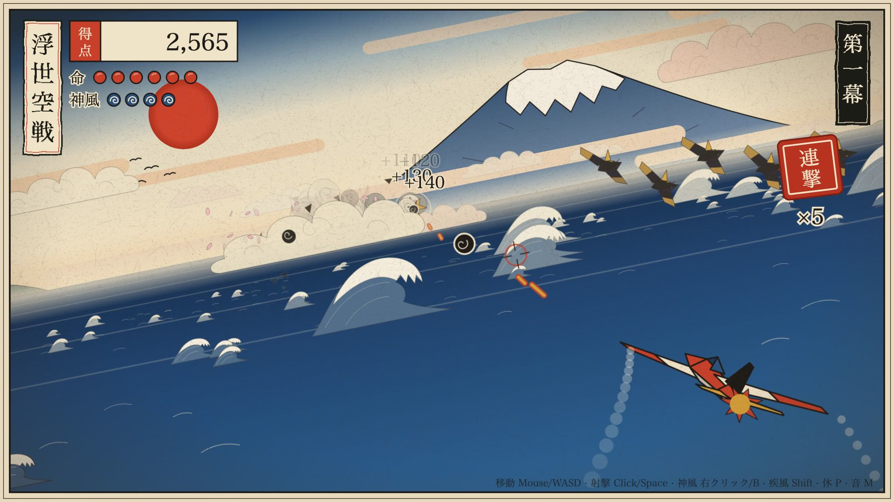

# 浮世空戦 · Ukiyo-e Sky War

浮世绘风格的 3D 即时空战游戏，**整个游戏就是一个 SVG 文件**（约 70 KB）。没有 Canvas、没有 WebGL、不加载任何外部资源。

**在线游玩 → https://futrime.github.io/ukiyo-sky-war/**
也可以下载 [`ukiyo-sky-war.svg`](ukiyo-sky-war.svg)，直接拖进浏览器打开。

## 操作

| 动作 | 按键 |
|---|---|
| 移动 | 鼠标 / WASD / 方向键 |
| 射击（追尾矢） | 按住左键 / Space |
| 神风（全屏一掃） | 右键 / B / 触屏双击 |
| 疾风（加速） | Shift |
| 暂停 / 静音 | P / M |

击落鬼凧与提灯，在第 70 秒左右迎战从海中升起的龙神。金色御守会补充「命」或「神风」，每打倒一次龙神进入下一幕，难度随之提高。

## 技术要点

- **自写软件 3D 管线**：顶点变换、透视投影、背面剔除、三档量化光照，按深度排序后画成一池复用的 SVG `<path>`（画家算法）。
- **浮世绘画面**：普鲁士蓝渐变天空（bokashi）、北斋式浪头、富士山、霞带、木版粗墨线、和纸纹理与印章式 UI；远景会融进米色雾气。
- **龙神 Boss**：24 节管状身体沿延迟路径游动，背鳍、龙角、随风飘动的龙须。
- **特效**：墨色爆炸、卷云烟、樱花瓣、震屏、神风漩涡、尾迹云。
- **声音**：WebAudio 实时合成射击声、太鼓、锣和都节音阶古筝。
- 文件内有一个可选的观测接口 `window.__ukiyoProbe`，只在宿主页面主动注入时启用，用于录制与回放工具；正常游玩时不暴露任何内容。

---

A ukiyo-e styled 3D aerial shooter that lives entirely inside one interactive SVG file: a hand-written software 3D renderer (projection, back-face culling, quantized lighting, painter's-sort into pooled `<path>` elements), procedural woodblock-print art and WebAudio-synthesized sound.
